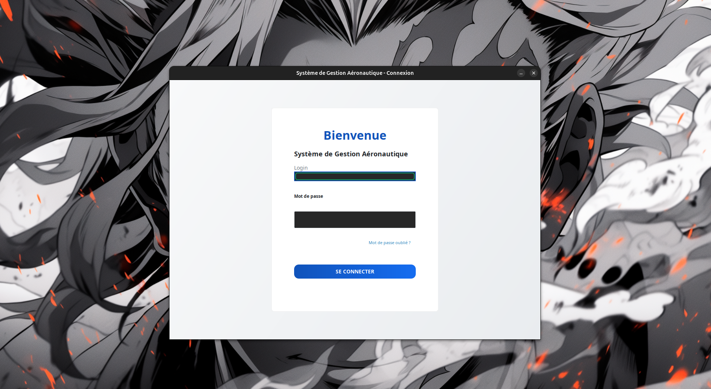
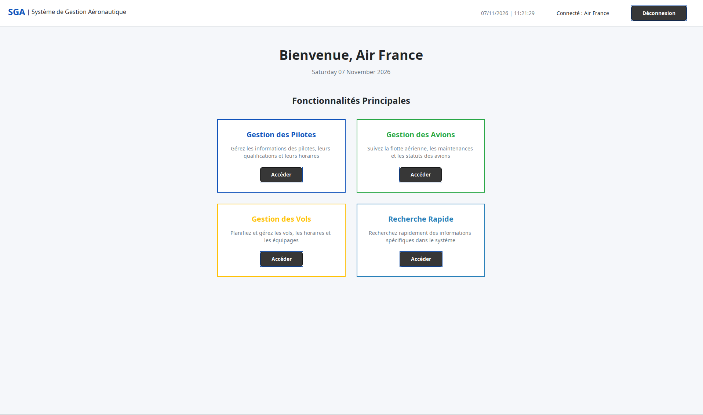
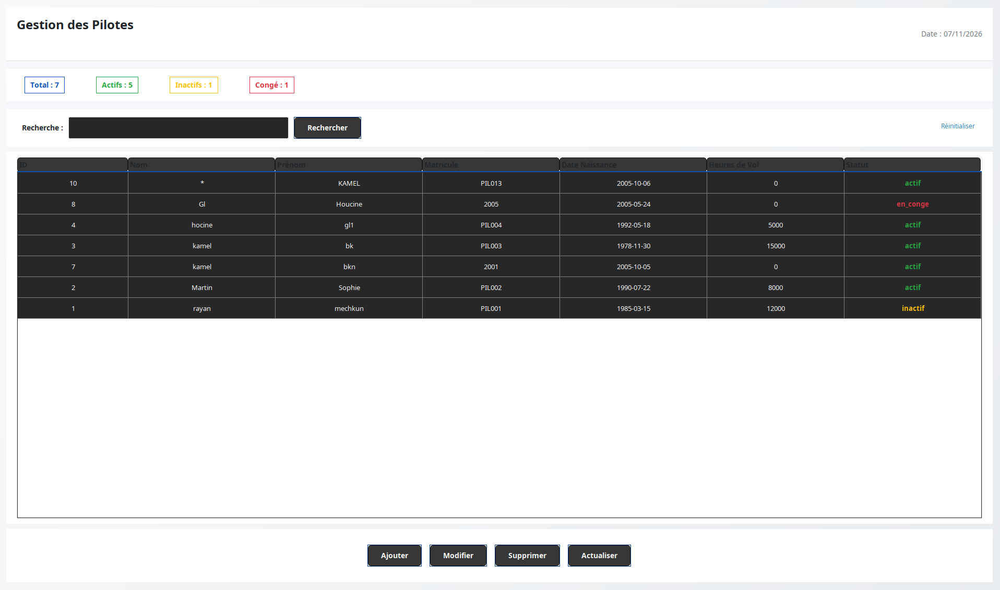
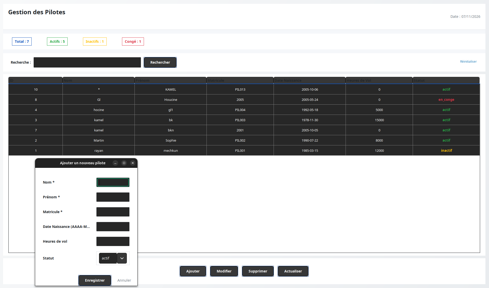
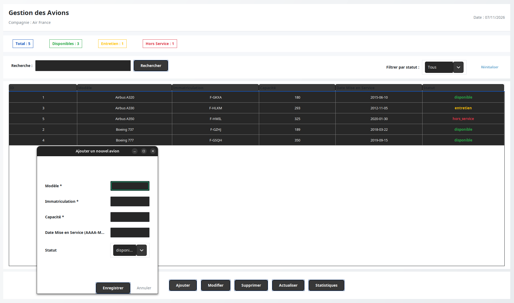
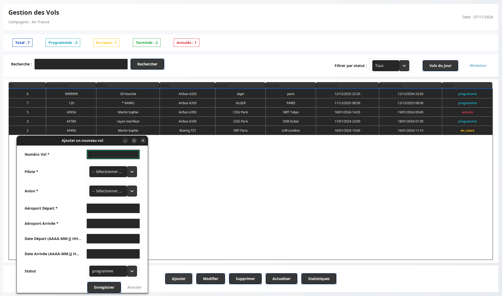
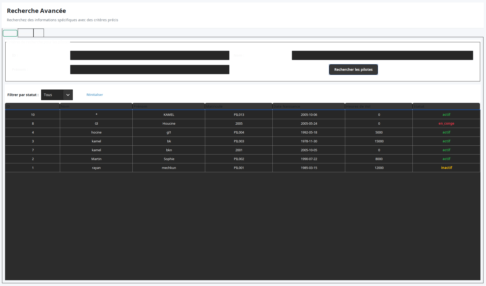

# ✈️ Système de Gestion Aéronautique (SGA)

Application de bureau Java (Swing) de **gestion des vols d'une compagnie aérienne** : pilotes, avions, vols et recherche avancée, avec authentification et base de données MySQL.

> **Mini-projet — Génie Logiciel** · 3ème année Ingénieur, Département d'Informatique
> Faculté des Sciences Exactes, Université Abderrahmane Mira de Béjaia
> Chargée de cours : L. Hamza · Chargées de TP : N. Bair & S. Boussoufa

**Réalisé par :** BOUKHENAK Kamel · GUELAACHE Houcine

---

## 📑 Sommaire

1. [Présentation](#-présentation)
2. [Fonctionnalités](#-fonctionnalités)
3. [Aperçu de l'application](#-aperçu-de-lapplication)
4. [Technologies](#-technologies)
5. [Structure du projet](#-structure-du-projet)
6. [Base de données](#-base-de-données)
7. [Installation et exécution](#-installation-et-exécution)
8. [Utilisation](#-utilisation)
9. [Conception (UML)](#-conception-uml)
10. [Dépannage](#-dépannage)
11. [Perspectives d'amélioration](#-perspectives-damélioration)

---

## 📖 Présentation

Dans une compagnie aérienne, chaque vol est assuré par **un avion** et **un pilote**. Ce projet permet de :

- analyser et modéliser le besoin (cahier des charges, cas d'utilisation, diagramme de classes, diagrammes de séquence) ;
- traduire le modèle en **schéma relationnel** MySQL ;
- réaliser une application qui gère ces informations, avec une interface graphique moderne.

Le rapport complet du projet (analyse, UML, modèle de données) accompagne ce dépôt : `AeronautiqueApp-rapport.pdf`.

**Fonctionnalités exclues** (cahier des charges) : réservation / vente de billets, suivi en temps réel des vols, gestion de la maintenance.

---

## ✨ Fonctionnalités

### 🔐 Authentification
- Page de connexion (login + mot de passe).
- Le mot de passe est stocké **haché en SHA-256** dans la base.
- Le nom de la compagnie connectée s'affiche dans toutes les fenêtres.

### 👨‍✈️ Gestion des pilotes
- Ajouter, modifier, supprimer, actualiser.
- Informations : nom, prénom, matricule (unique), date de naissance, heures de vol, statut (`actif`, `inactif`, `en_conge`).
- Compteurs en temps réel : total, actifs, inactifs, en congé.
- Recherche par mot-clé.

### 🛩️ Gestion des avions
- Ajouter, modifier, supprimer, actualiser.
- Informations : modèle, immatriculation (unique), capacité (passagers), date de mise en service, statut (`disponible`, `entretien`, `hors_service`).
- Compteurs : total, disponibles, en entretien, hors service.
- Recherche par mot-clé + **filtre par statut**.
- Fenêtre de **statistiques** de la flotte.

### 🌍 Gestion des vols
- Ajouter, modifier, supprimer, actualiser.
- Informations : numéro de vol (unique), pilote, avion, aéroport de départ, aéroport d'arrivée, date/heure de départ et d'arrivée, statut (`programme`, `en_cours`, `termine`, `annule`).
- Le pilote et l'avion se choisissent dans des **listes déroulantes** alimentées par la base.
- Compteurs : total, programmés, en cours, terminés, annulés.
- Recherche par mot-clé, **filtre par statut**, bouton **« Vols du Jour »**.
- Fenêtre de **statistiques** des vols.

### 🔎 Recherche avancée
- Fenêtre à onglets **Pilotes / Avions / Vols**.
- Recherche par critères précis (ex. pilotes : ID, nom, prénom) et filtre par statut.

### 🛡️ Intégrité et validation
- Vérification des **champs obligatoires** (marqués par `*`) avec message d'erreur clair.
- Vérification du **format des dates** (`AAAA-MM-JJ HH:MM:SS`).
- Numéro de vol, matricule, immatriculation et login **uniques** (contraintes `UNIQUE`).
- **Clés étrangères** : un pilote ou un avion rattaché à un vol ne peut pas être supprimé tant que ce vol existe.

---

## 🖼️ Aperçu de l'application

### Connexion


### Tableau de bord
Accès aux quatre modules : pilotes, avions, vols et recherche rapide.



### Gestion des pilotes


Formulaire d'ajout d'un pilote :



### Gestion des avions
Liste de la flotte, filtre par statut et formulaire d'ajout.



### Gestion des vols
Liste des vols (pilote, avion, trajet, dates, statut) et formulaire d'ajout.



### Recherche avancée


---

## 🛠️ Technologies

| Élément | Choix |
|---|---|
| Langage | Java 11 |
| Interface graphique | Java Swing (look and feel du système) |
| Base de données | MySQL / MariaDB (via XAMPP) |
| Accès aux données | JDBC + pattern **DAO** |
| Gestion du projet | Maven |
| Pilote JDBC | `mysql-connector-java` 8.0.33 |
| IDE conseillé | Apache NetBeans |
| Modélisation | StarUML (cas d'utilisation, classes, séquence) |

---

## 📂 Structure du projet

```
BOUKHENAK KAMEL GUELAACHE HOCINE G1/
├── AeronautiqueApp/                 ← projet Maven (à ouvrir dans NetBeans)
│   ├── pom.xml
│   └── src/main/java/
│       ├── com/mycompany/aeronautiqueapp/
│       │   └── AeronautiqueApp.java     ← point d'entrée (main)
│       ├── database/
│       │   ├── DatabaseConnection.java  ← connexion JDBC
│       │   └── DatabaseSetup.java       ← création auto de la base et des tables
│       ├── models/                      ← Avion, Pilote, Vol, User
│       ├── dao/                         ← AvionDAO, PiloteDAO, VolDAO, UserDAO
│       └── views/                       ← fenêtres Swing
│           ├── LoginFrame.java
│           ├── DashboardFrame.java
│           ├── PiloteManagementFrame.java
│           ├── AvionManagementFrame.java
│           ├── VolManagementFrame.java
│           └── RechercheFrame.java
├── compagnie_aerienne.sql           ← script SQL (structure + données de démonstration)
├── screenshots/                     ← captures d'écran de ce README
└── README.md
```

**Architecture :** `views` (interface) → `dao` (accès aux données) → `database` (connexion) → MySQL, avec `models` pour les objets métier.

---

## 🗄️ Base de données

Nom de la base : **`compagnie_aerienne`**

| Table | Colonnes principales |
|---|---|
| `utilisateurs` | `id`, `nom_compagnie`, `login` (unique), `mot_de_passe` (SHA-256), `email`, `date_creation` |
| `pilotes` | `id`, `nom`, `prenom`, `matricule` (unique), `date_naissance`, `heures_vol_total`, `statut` |
| `avions` | `id`, `modele`, `immatriculation` (unique), `capacite_passagers`, `date_mise_en_service`, `statut` |
| `vols` | `id`, `numero_vol` (unique), `pilote_id` → `pilotes`, `avion_id` → `avions`, `aeroport_depart`, `aeroport_arrivee`, `date_depart`, `date_arrivee`, `statut` |

**Relations :**
- un pilote peut piloter **plusieurs** vols ;
- un avion peut assurer **plusieurs** vols au cours du temps ;
- chaque vol est associé à **un seul** pilote et **un seul** avion (clés étrangères).

La table `utilisateurs` représente le compte de la compagnie qui se connecte à l'application.

---

## 🚀 Installation et exécution

### Prérequis

- **JDK 11 ou plus récent**
- **Apache NetBeans** (avec support Maven)
- **XAMPP** (MySQL sur le port `3306`, utilisateur `root`, mot de passe vide)
- Une connexion internet **la première fois** (téléchargement du pilote MySQL par Maven)

### Étape 1 — Démarrer MySQL

Ouvrir le panneau XAMPP et démarrer **MySQL** (Apache n'est nécessaire que pour phpMyAdmin).

### Étape 2 — Préparer la base de données (au choix)

**Option A — Importer le script SQL (avec les données de démonstration)**
1. Ouvrir `http://localhost/phpmyadmin`.
2. Créer une base vide nommée **`compagnie_aerienne`**.
3. La sélectionner, puis *Importer* → choisir `compagnie_aerienne.sql` → *Exécuter*.

**Option B — Création automatique**
Ne rien faire : au premier lancement, `DatabaseSetup` crée la base, les tables et le compte administrateur (sans données de démonstration).

### Étape 3 — Ouvrir le projet dans NetBeans

1. *File → Open Project…*
2. Sélectionner le dossier **`AeronautiqueApp`** (l'icône Maven doit apparaître).

### Étape 4 — Lancer

Clic droit sur le projet → **Run** (ou touche `F6`).
Si NetBeans demande la classe principale : `com.mycompany.aeronautiqueapp.AeronautiqueApp`.

### Étape 5 — Se connecter

| Login | Mot de passe |
|---|---|
| `admin` | `admin123` |

### Configuration de la connexion

Si votre MySQL utilise d'autres paramètres, modifier `database/DatabaseConnection.java` :

```java
private static final String URL = "jdbc:mysql://localhost:3306/compagnie_aerienne?useSSL=false&serverTimezone=UTC";
private static final String USER = "root";
private static final String PASSWORD = "";
```

### Générer un JAR (optionnel)

```bash
cd AeronautiqueApp
mvn clean package
```

> ⚠️ Avant de compresser ou partager le projet, faites **Clean** (ou supprimez le dossier `target/`) : il contient des fichiers compilés propres à votre machine.

---

## 🧭 Utilisation

1. **Se connecter** avec `admin` / `admin123`.
2. Depuis le **tableau de bord**, choisir un module (*Accéder*).
3. **Ajouter** : cliquer sur *Ajouter*, remplir le formulaire (champs `*` obligatoires), puis *Enregistrer*.
4. **Modifier / Supprimer** : sélectionner une ligne du tableau puis cliquer sur *Modifier* ou *Supprimer* (une confirmation est demandée avant la suppression).
5. **Rechercher** : saisir un mot-clé puis *Rechercher* ; *Réinitialiser* efface le filtre.
6. **Créer un vol** : s'assurer qu'au moins un pilote et un avion existent, car ils sont choisis dans les listes déroulantes.
7. **Se déconnecter** avec le bouton *Déconnexion* du tableau de bord.

**Formats de saisie**
- Date (pilote, avion) : `AAAA-MM-JJ` — ex. `2005-10-06`
- Date et heure (vol) : `AAAA-MM-JJ HH:MM:SS` — ex. `2025-12-11 07:30:00`

---

## 📐 Conception (UML)

Les diagrammes complets sont dans le rapport (`AeronautiqueApp-rapport.pdf`) :

- **Diagramme de cas d'utilisation** : l'utilisateur s'authentifie, puis gère les avions, les pilotes, les vols et effectue des recherches (par numéro, avion, pilote, date, lieu de départ, lieu d'arrivée).
- **Diagramme de classes** : `Compagnie`, `Avion`, `Pilote`, `Vol`, avec leurs multiplicités (une compagnie possède plusieurs avions et pilotes ; un avion et un pilote peuvent assurer plusieurs vols).
- **Diagrammes de séquence** : gestion des avions, des pilotes et des vols (ajout, modification, suppression, consultation).

### Écarts entre le cahier des charges et la version réalisée

| Cahier des charges / rapport | Application réalisée |
|---|---|
| Application web | Application **de bureau** Java Swing |
| Table `Compagnie` (`codeCompagnie`, siège social) | Table `utilisateurs` : un compte = une compagnie |
| Clés textuelles (`codeAv`, `numeroVol`) | Clés numériques auto-incrémentées + champs uniques (`immatriculation`, `numero_vol`) |
| Vol avec ville de départ / arrivée et une date | Vol avec **aéroports** de départ / arrivée, **date et heure** de départ et d'arrivée, et statut |
| Avion : code, type, modèle, nb de places | Avion : modèle, immatriculation, capacité, date de mise en service, statut |

---

## 🩺 Dépannage

| Problème | Solution |
|---|---|
| « Erreur de connexion à XAMPP » | Démarrer MySQL dans XAMPP ; vérifier le port `3306` et les identifiants dans `DatabaseConnection.java`. |
| « Driver MySQL non trouvé » | Lancer le projet avec une connexion internet pour que Maven télécharge le pilote (ou faire *Clean and Build*). |
| Erreur de version Java | *Propriétés du projet → Build → Compile* : choisir un JDK 11 ou plus. |
| Comportement étrange après avoir reçu le projet d'une autre machine | Supprimer le dossier `target/` puis relancer. |
| Connexion refusée | Utiliser `admin` / `admin123` ; si la base a été importée, vérifier que la table `utilisateurs` contient ce compte. |
| Un pilote / avion ne se supprime pas | Normal : il est utilisé par un ou plusieurs vols. Supprimer ou réaffecter d'abord ces vols. |

---

## 🔭 Perspectives d'amélioration

- Module de **réservation** et **suivi en temps réel** des vols.
- **Tableau de bord analytique** (performances de la compagnie, utilisation des avions et des pilotes).
- Gestion de la **maintenance** des avions et alertes de sécurité.
- Détection automatique des **conflits d'horaires** (avion ou pilote déjà affecté sur la même période).
- Gestion de plusieurs compagnies et de rôles utilisateurs.

---

## 👥 Auteurs

- **BOUKHENAK Kamel**
- **GUELAACHE Houcine**

Université Abderrahmane Mira de Béjaia — Année universitaire 2025/2026
